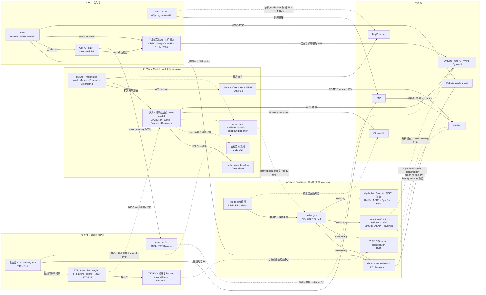

# Related Work 总入口：World Model × Test-Time Training × Real-to-Sim-to-Real × RL

> 本目录收录 54 篇：50 篇论文加 4 篇综述，分五个主题。01 World Model 11 篇，02 Test-Time Training 12 篇，03 Real-to-Sim-to-Real 12 篇，04 RL 11 篇，05 交叉 8 篇。元数据在 [`index.json`](./index.json)。
> 本页是总入口，内容包括：四条线的统一视角、概念地图、跨主题学习路线、总索引、复现队列、交叉处的开放问题，以及加新论文的流程。每个主题的脉络、分类、机制对比表和扩展阅读，见各主题 README。
> 本页数字都取自各主题 README 和各篇 `notes.md`，笔记里的数字能在对应论文的 `source/` 或 `paper.pdf` 中找到出处。标"本文整理"或"笔者"的是本页的归纳或推断，不是论文结论。
> 最后更新：2026-09-28

**怎么用这一页**

- 第一次来：读 §1 和 §2，然后从 §3 的阶段 0 开始。
- 找某篇论文：看 §4。
- 准备动手：看 §5。复现报告放在 [`../复现/`](../复现/)。
- 找选题：看 §6，讨论过程记在 [`../brainstorm.md`](../brainstorm.md)。

**目录**

1. [四条线各回答什么问题，为什么放在一起学](#1-四条线各回答什么问题为什么放在一起学)
2. [概念地图](#2-概念地图)
3. [学习路线](#3-学习路线)
4. [总索引](#4-总索引)
5. [复现队列](#5-复现队列)
6. [交叉处的开放问题](#6-交叉处的开放问题)
7. [如何加新论文](#7-如何加新论文)

---

## 1. 四条线各回答什么问题，为什么放在一起学

一句话概括：本项目把四条线看成同一个闭环里的三类部件。第一类是 **simulator**，它有两种来源：学出来的叫 world model（learned simulator），用真实数据重建或校准出来的属于 real-to-sim。第二类是**优化器**，即 RL，它在 simulator 里或真实世界里优化 policy。第三类是**部署时的适应**，即 TTT / TTA。

| 线 | 核心问题 | 在统一视角里的角色 | 代表性证据 | 典型失效 |
|---|---|---|---|---|
| [04 RL](./04_rl/README.md) | 没有逐步的正确动作标注，只有标量 reward 时，怎样靠交互学到期望回报最大的 policy | 优化器：在仿真器、world model 或真实世界里优化 policy；2024 年后主要用于对预训练策略做后训练 | 04 README 的归纳：不需要真实数据的方法（DPPO、SimpleVLA-RL、π_RL）都依赖可重置的仿真器，需要真实数据的方法（HIL-SERL、π\*0.6）都依赖人 | on-policy 样本量大（DPPO 从 Robomimic 的 3e6 步到 Furniture 的 1e9 步）；reward 被 hack（R1 用 helpful RM 训练时 RM 分数上升、CodeForces 下降） |
| [03 Real2Sim2Real](./03_real2sim2real/README.md) | 仿真在 dynamics、perception、actuation、system design 上和真实不一致时，怎样让仿真里训出的 policy 在真机上仍然好用 | 重建或校准出来的 simulator。用真实数据构建、修正物理仿真（reducing the gap），剩余的 gap 靠 DR 或在线适应克服（overcoming the gap） | 目标是缩小 performance gap $G_{\text{perf}}$，不是把 reality gap 清零；SimOpt 每轮只用 3 条真机 rollout 更新参数分布；SIMPLER 只要求仿真与真实的排名一致（Bridge 上 MMRV 0.014） | 参数化仿真修不了结构性误差；RMA 超出训练随机化的支撑集后就无法继续适应 |
| [01 World Model](./01_world_model/README.md) | 能否从数据学出"环境在动作下怎样演化"的模型，用来规划、训练 policy、评估 policy 或合成数据 | 学出来的 simulator；到 DreamZero 这一步，world model 本身就是 policy | World Models 的 controller 全程在梦境里训练；RWM 在 GRU world model 里开 4096 个 imagination 环境跑 PPO，策略 zero-shot 部署到 ANYmal D 和 G1 | model exploitation 与 compounding error：World Models 在 τ=0.1 时梦境得分 2086、真实得分 193 |
| [02 TTT](./02_test_time_training/README.md) | 部署时遇到分布偏移或新信息，能否用不需要标签的信号更新模型的一部分状态 | 部署时的适应：不改 simulator，直接在部署时修 policy 或 world model | PAD 部署时只用 inverse dynamics 损失更新 encoder，36 个测试环境中 31 个有提升；SimDist 在真机上用约 30 分钟数据只 finetune latent dynamics | 自监督信号与控制目标不一致时，性能会在无人察觉时下降（PAD 在 CRLMaze 的训练环境上从 585 跌到 −416）；SimDist 解冻 encoder 后成功率跌到 0 |

### 为什么放在一起学：五条证据

1. **两类 simulator 面对的是同一种 gap。**
   - 物理仿真与真实之间的差异叫 reality gap。[Reality Gap 综述](./03_real2sim2real/survey-reality-gap/notes.md)把 sim-to-real 的目标定为缩小 $G_{\text{perf}}=|J_{\mathcal M_s}(\pi)-J_{\mathcal M_r}(\pi)|$。
   - learned simulator 里对应的是 model error，policy 去利用这种误差就是 model exploitation。[World Models](./01_world_model/world-models/notes.md) 在 τ=0.1 时梦境得分 2086，真实得分只有 193，比随机策略还低。[Ctrl-World](./05_intersections/ctrl-world/notes.md) 的想象成功率对真机成功率的回归线是 $y=0.81x-0.11$。
   - [05 README](./05_intersections/README.md) 的总结是：learned simulator 没有消除 gap，只是把 sim-to-real gap 换成了 world model 与真实之间的误差。所以 03 的度量工具（$G_{\text{perf}}$、SRCC、SIMPLER 的 MMRV）可以直接拿来评估 world model。

2. **"用真实数据修仿真"和"从数据学模型"处在同一条连续谱上。**
   - [SimOpt](./03_real2sim2real/simopt/notes.md) 只调参数分布；[ASAP](./03_real2sim2real/asap/notes.md) 学动作空间的残差。
   - ASAP 的 DeltaDynamics 基线学状态残差，相当于把一个 learned dynamics 嵌进仿真器。
   - [RWM](./05_intersections/robotic-world-model/notes.md) 和 [SimDist](./05_intersections/simdist/notes.md) 把整个 dynamics 换成了神经网络。
   - [PhysTwin](./03_real2sim2real/phystwin/notes.md) 的 Eq.2 由 transition 和 observation model 组成，靠最小化观测误差来拟合，和 RSSM 的训练目标同构。
   - 越往"学整个模型"的一端走，覆盖面越广，compounding error 也越成为主要问题。

3. **同一套优化器同时驱动两类 simulator。**
   - PPO 在物理仿真一侧是 legged-gym、RMA、SimOpt、RialTo、ASAP、X-Sim 的优化器；在 learned simulator 一侧，RWM 用它在 GRU world model 里训练策略（MBPO-PPO）。
   - GRPO 在 [SimpleVLA-RL](./04_rl/simplevla-rl/notes.md) 里跑在物理仿真中，在 [WMPO](./05_intersections/wmpo/notes.md) 和 [World-Gymnast](./05_intersections/world-gymnast/notes.md) 里跑在视频 world model 中（WMPO 除 world model 以外的设置都沿用 SimpleVLA-RL），在 [TTRL](./02_test_time_training/ttrl/notes.md) 里跑在测试题上。
   - 按 [04 README](./04_rl/README.md) 的说法，05 交叉线的出发点就是用 world model 替代 04 线里那个"可重置的仿真器"，或者替代真机 RL 里的人力（[HIL-SERL](./04_rl/hil-serl/notes.md)、[π\*0.6](./04_rl/pi-star-06/notes.md) 都需要人提供示范、干预或标签）。

4. **部署时适应在另外三条线里几乎是空白，这正是交叉口。**
   - 01：所有收录的 world model 部署时都冻结参数。
   - 03：没有一篇在部署时对仿真参数、delta action model 或 policy 做梯度更新。RMA 只做前向推断，超出随机化支撑集就不能再学。
   - 04：部署时做 test-time RL，在小样本、非平稳的数据上 ε、epoch 数、KL 正则该怎么设，收录的论文都没有回答。
   - 02 提供了机制：自监督辅助损失、entropy、fast weights、伪奖励。它也带来自己的问题：信号是否与控制目标对齐（TTT 的 Theorem 1 条件在测试时无法检验），以及长时程运行会不会 collapse。
   - 具身场景里用自监督信号做部署期更新的先例只有两个：[PAD](./05_intersections/pad/notes.md) 和 SimDist。[World-Gymnast](./05_intersections/world-gymnast/notes.md) 所说的 TTT 是从测试帧出发、在 world model 里用 VLM reward 做 test-time RL，更新信号是 reward，不是自监督损失。

5. **SimDist 一篇就用到了四条线**，可以当作"四条线怎样拼起来"的样板：
   - 在仿真里用 PPO 加 DR 训练 privileged expert（03、04）；
   - world model 是 TD-MPC 式的 latent world model，配合 MPPI 规划（01）；
   - 到真机上用自监督的 latent 预测损失只更新 dynamics（02），把真实世界的适应化简为 supervised system identification（03）；
   - 对照的 RL 基线是 RLPD 和 IQL（04）。

### 适应发生在哪里、什么时候（本文整理）

下表按"修正的对象"和"修正的时机"两个维度，把四条线的做法放在一起。空格就是还没有人做过的组合。

| 修正的对象 \ 时机 | 训练前 | 两次部署之间（离线，用真实数据） | 部署时，只做前向推断 | 部署时，做梯度更新 |
|---|---|---|---|---|
| 物理仿真器（参数、外观、场景） | 随机化：[DR](./03_real2sim2real/domain-randomization/notes.md)、[legged-gym](./03_real2sim2real/legged-gym/notes.md)；重建：[RialTo](./03_real2sim2real/rialto/notes.md)、[ACDC](./03_real2sim2real/acdc-digital-cousins/notes.md)、[SplatSim](./03_real2sim2real/splatsim/notes.md)、[PhysTwin](./03_real2sim2real/phystwin/notes.md)、[X-Sim](./03_real2sim2real/x-sim/notes.md) | [SimOpt](./03_real2sim2real/simopt/notes.md)（参数分布）、[ASAP](./03_real2sim2real/asap/notes.md)（delta action model） | — | **空**。PhysTwin 笔记指出，部署时用新观测持续更新物理参数是自然延伸，但论文没做 |
| learned simulator（world model） | 离线训练：Dreamer 系、[RWM](./05_intersections/robotic-world-model/notes.md)、[Cosmos](./01_world_model/cosmos-wfm/notes.md)、[UniSim](./05_intersections/unisim/notes.md) 等 | WMPO lifelong、World-Gymnast Dyna（都是用真实环境 rollout 微调 world model；WMPO lifelong 只在 Mimicgen 仿真的 StackThree 上做过，这里的"真实环境"就是该仿真器，World-Gymnast Dyna 用的是 AutoEval 真机轨迹） | 上下文内的状态更新：Dreamer 的 posterior、[DreamZero](./01_world_model/dreamzero/notes.md) 把真实帧写回 KV cache、Ctrl-World 的 memory retrieval | [SimDist](./05_intersections/simdist/notes.md)（只 finetune latent dynamics，按批迭代，不是逐步在线） |
| policy | BC / RL 训练 | [X-Sim](./03_real2sim2real/x-sim/notes.md)（部署后离线做 InfoNCE 校准）；[π\*0.6](./04_rl/pi-star-06/notes.md)（每轮收集真机 rollout 和人类纠正，再做 iterated offline RL） | [RMA](./03_real2sim2real/rma/notes.md)（adaptation module 推断 extrinsics） | [PAD](./05_intersections/pad/notes.md)（自监督更新 encoder）；World-Gymnast 的 TTT（从测试帧出发，在 world model 里做 test-time RL） |

TTT layers 这类序列层（[TTT layers](./02_test_time_training/ttt-layers/notes.md)、[Titans](./02_test_time_training/titans/notes.md)）在前向过程中用梯度更新 fast weights，每条序列都重新开始。[TTI 综述](./02_test_time_training/survey-test-time-intelligence/notes.md)把它算作 test-time learning，[KV-binding 一文](./02_test_time_training/ttt-kv-linear-attention/notes.md)则论证它在代数上就是 learned linear attention。它还没有被用到本项目收录的任何 policy 或 world model 上，所以没有放进表里。

---

## 2. 概念地图

实线表示论文中已有的直接继承或使用关系；虚线表示类比、争议，或本项目的候选假设（未验证）。



**读图要点**

- 03 与 01 之间只有一条虚线，从 `model error` 连到 `reality gap`。它是本项目的出发点：两类 simulator 面对的是同一个问题。
- 02 指向 01 的两条虚线（部署时修正 model error；fast weights 当长程记忆）都还没有论文做过，对应 §6 的 Q1 和 Q7。
- 05 里的节点都至少有两条来自不同主题的入边，这正是 05 的收录标准：同时跨两条以上主线。（DayDreamer 的第二条入边是虚线：SAC 是它在真机上的 model-free 对照，A1 上 SAC 只学会翻身。）

---

## 3. 学习路线

按每周约 10 小时估算，全程约 21–25 周。排序原则是**概念先介绍、再使用**，每个阶段都列出"本阶段引入的概念"和"用到前面哪些阶段"。各主题 README 里有更细的前置 checklist，本页只给跨主题的主干。

| 阶段 | 主题 | 预计周数 | 读几篇 | 配套动手（本机 macOS 能不能做） |
|---|---|---|---|---|
| 0 | RL 基础 | 2–3 | 4 | 复现 ① PPO（CPU，可以） |
| 1 | reality gap 与重建出来的 simulator | 4 | 12 | MuJoCo 上的 sim-to-sim $G_{\text{perf}}$ 小实验（CPU，可以）；legged-gym、SIMPLER（需要 Linux 加 NVIDIA） |
| 2 | 学出来的 simulator：world model 骨架 | 3–4 | 8 | GRU world model：teacher forcing 对比自回归训练（CPU，可以）；复现 ③ TD-MPC2（需要 GPU） |
| 3 | 部署时的适应：TTT / TTA 与 fast weights | 4–5 | 11 | TTT layers 的等价性检查（CPU，可以）；复现 ② PAD（单卡） |
| 4 | 预训练策略的 RL 后训练与 test-time RL | 4 | 10 | GRPO advantage 手算（纸面）；DPPO（单卡） |
| 5 | 汇合：视频 world model 与 learned simulator 里的 VLA RL | 4–5 | 9 篇，另回读 3 篇综述 | 用 SIMPLER 的 MMRV 给 Ctrl-World 的 Table 3 打分（CPU，可以）；复现 ④–⑥ |

关于顺序的说明：

- 阶段 1 和阶段 2 的主体可以互换。本页先讲 reality gap，是为了读到 World Models 的 model exploitation 时，能直接用 $G_{\text{perf}}$ 的语言去描述它。如果先读阶段 2，要把其中的 Robotic World Model（用到 legged-gym 的配方和 DR）、两个 CPU 练习（用到阶段 1 的伪真实 Hopper 环境）以及自测第 1、5 题挪到阶段 1 之后。
- 阶段 3 的序列层部分（TTT layers 到 KV-binding）和阶段 4 的 LLM 部分（ARC TTT、TTRL、TTT-Discover），与其他阶段的依赖较弱，时间紧可以往后放。但阶段 5 的 World-Gymnast 要用到 test-time RL 的设定，往后放时至少先读 TTRL；§6 的 Q7 要用到序列层部分。
- 阶段 5 依赖前面所有阶段，不要提前。

### 阶段 0：RL 基础（2–3 周）

- **目标**：掌握 MDP / POMDP、value 与 advantage、on-policy 与 off-policy、policy gradient 与 actor-critic；能说清 PPO 和 SAC 各自的前提。后面所有"在 simulator 里优化 policy"的内容都建立在这里。
- **本阶段引入的概念**：MDP / POMDP、value 与 advantage、Bellman 方程、MC 与 TD、bootstrapping、on-policy 与 off-policy、deadly triad、experience replay、policy gradient、actor-critic、likelihood-ratio（REINFORCE）与 pathwise（重参数化）两种梯度估计器、GAE、trust region、maximum entropy RL。另外补一下 VAE 与 ELBO，阶段 2 要用。
- **要读**：[RL Overview 综述](./04_rl/survey-rl-overview/notes.md)（原书 Ch1 的 §1.1–1.3、§2.5、§3.1–3.2；Ch4 的 model-based RL 部分先略读）→ [DQN](./04_rl/dqn/notes.md) → [PPO](./04_rl/ppo/notes.md) → [SAC](./04_rl/sac/notes.md)
- **配套动手**：复现 ① PPO（见 §5）：在 Hopper 和 HalfCheetah 上比较不加约束、clip ε=0.2、adaptive KL 三种设置，记录 approx-KL 和 clip fraction。可选：SAC 在 HalfCheetah 上扫 reward scale ∈ {1, 5, 30}，CPU 可跑。
- **细节**：[04 README](./04_rl/README.md) 第 4 节的阶段 0–1。
- **阶段结束自测**
  1. 用了 experience replay，为什么就必须 off-policy？DQN 2013 版算 TD target 用的是哪组参数，和 Nature 版有什么不同？
  2. 设 ε=0.2、$\hat A<0$，$r_t=1.5$ 和 $r_t=0.7$ 的样本梯度分别是否为 0？PPO 的 clip 能不能保证 KL ≤ δ？
  3. PPO 用 likelihood-ratio 梯度，SAC 用 pathwise（重参数化）梯度。两者分别要求"策略似然可算"还是"critic 可微"？
  4. 为什么样本便宜时（大规模并行仿真）常用 PPO，样本贵时（真机）常用 SAC 系方法？

### 阶段 1：reality gap 与重建出来的 simulator（4 周）

- **目标**：建立 sim-to-real 的问题框架，包括 reality gap 与 performance gap 的区别、reducing 与 overcoming 两类做法；掌握"仿真里用 PPO 训练、真机上部署"的基本配方；看清真实数据进入仿真的几种方式（参数、残差、场景、外观）和评测口径。
- **本阶段引入的概念**：reality gap、$G_{\text{perf}}$、domain randomization、system identification、privileged information 与 teacher-student 蒸馏、behavior cloning（BC）与 DAgger、digital twin / digital cousin、3D Gaussian Splatting、delta action（residual）model、REPS / CMA-ES 这类黑箱优化与可微仿真（SimOpt、PhysTwin 用）、real-to-sim 评测、MMRV。
- **用到**：阶段 0 的 PPO、GAE、POMDP、trust region（SimOpt 的 KL 约束）。
- **本阶段先当黑箱用的**：SplatSim、X-Sim 的学生策略是 Diffusion Policy（一种 BC 策略类），这里只需知道它从示范学动作分布；扩散模型本身到阶段 2（DIAMOND）和阶段 4（DPPO）再展开。
- **要读**：[Reality Gap 综述](./03_real2sim2real/survey-reality-gap/notes.md)（先只读 Sec.2–4）→ [Domain Randomization](./03_real2sim2real/domain-randomization/notes.md) → [legged-gym](./03_real2sim2real/legged-gym/notes.md) → [RMA](./03_real2sim2real/rma/notes.md) → [SimOpt](./03_real2sim2real/simopt/notes.md) → [RialTo](./03_real2sim2real/rialto/notes.md) → [SplatSim](./03_real2sim2real/splatsim/notes.md) → [ACDC](./03_real2sim2real/acdc-digital-cousins/notes.md) → [SIMPLER](./03_real2sim2real/simpler/notes.md) → [ASAP](./03_real2sim2real/asap/notes.md) → [PhysTwin](./03_real2sim2real/phystwin/notes.md) → [X-Sim](./03_real2sim2real/x-sim/notes.md)
- **配套动手**
  - 纸面：把本线 11 篇论文填进 §1 的"修正的对象 × 时机"表，并标出每篇针对的是 perception、actuation、dynamics、system 中哪几类 gap。
  - CPU（笔者建议，不是论文实验）：在阶段 0 的 PPO 代码上，把 Hopper 的标称环境当作 $\mathcal M_s$；改变质量和摩擦、加入动作延迟，得到伪真实环境 $\mathcal M_r$。比较只在标称参数上训练和加 DR 训练两种 policy 的 $J_{\mathcal M_r}$ 与 $G_{\text{perf}}$。这是 [03 README](./03_real2sim2real/README.md) 第 9 节为 legged-gym 设计的 gap 审计的缩小版，之后阶段 2、3 的练习都复用这个伪真实环境。
  - 有 Linux 加 NVIDIA 时：legged-gym 的 `anymal_c_flat` 训练，加 time-out bootstrap 的开关对照（Fig.10）；或者直接做复现 ⑥ SIMPLER。
- **细节**：[03 README](./03_real2sim2real/README.md) 第 5 节的阶段 1–3。
- **阶段结束自测**
  1. reality gap（Eq.2）和 performance gap（Eq.4）分别依赖什么？为什么单独把 $\min_\pi G_{\text{perf}}$ 当训练目标会退化？
  2. RMA 为什么回归 $z$，而不是物理参数 $e$？Table II 中 SysID（56.5%）低于 Robust（62.4%）说明了什么？部署时 RMA 一个权重都不更新，那它的"适应"具体是什么？
  3. SimOpt 用 closed-loop 的 policy rollout，SIMPLER 用 open-loop 回放示范动作。两者各自辨识了什么？需要什么真实数据？
  4. RialTo 的 Fig.7（在 Objaverse 资产上训练，真实成功率 10%）和 ACDC 的 Fig.5（twin 25%、cousin 90%）结论看似相反，能否调和？
  5. SimOpt、ASAP、PhysTwin 修正的分别是什么表示？各自表达不了哪类 gap？

### 阶段 2：学出来的 simulator，world model 骨架（3–4 周）

- **目标**：掌握三种 world model 形态：latent MBRL（RSSM 加 imagination actor-critic）、decoder-free 加 MPC、像素扩散。理解 model exploitation 和 compounding error 就是 learned simulator 的 reality gap。读两个最早的交叉实例：world model 直接上真机（DayDreamer），world model 替代物理引擎（RWM）。
- **本阶段引入的概念**：world model、latent dynamics、RSSM、imagination / latent rollout、λ-return、symlog / twohot、KL balancing 与 free bits、MPC、CEM / MPPI、latent consistency 与 stop-gradient、DDPM（ε-prediction）与 EDM 扩散、model exploitation、compounding error、teacher forcing 与自回归训练。
- **用到**：阶段 0 的 actor-critic、pathwise 梯度、VAE；阶段 1 的 reality gap、DR 和 legged-gym 配方。
- **要读**：[WM for Robot Learning 综述](./01_world_model/survey-wm-robot-learning/notes.md)（只扫 Fig.2 和 Sec.3.1 当地图，精读放到阶段 5；它以 VLA 为中心，VLA 到阶段 4 才系统引入，这里遇到只需知道它是"视觉-语言-动作"策略）→ [World Models](./01_world_model/world-models/notes.md) → [Dreamer](./01_world_model/dreamer/notes.md) → [DreamerV3](./01_world_model/dreamerv3/notes.md) → [TD-MPC2](./01_world_model/tdmpc2/notes.md) → [DIAMOND](./01_world_model/diamond/notes.md) → [DayDreamer](./05_intersections/daydreamer/notes.md) → [Robotic World Model](./05_intersections/robotic-world-model/notes.md)
- **配套动手**
  - CPU：用阶段 1 的 Hopper 数据训练一个 GRU world model，比较 teacher forcing（$N=1$）与自回归训练（$M=32$、$N=8$）的多步预测误差曲线，看能否得到 RWM Fig. S8 的趋势（$N$ 从 1 到 2 到 8，误差从 3.99 到 1.91 到 0.47）。这是 RWM 笔记给出的无 GPU 退路。
  - GPU：复现 ③ TD-MPC2（先评估 checkpoint，再单任务训练）。
- **细节**：[01 README](./01_world_model/README.md) 第 5 节的阶段 1–2；[05 README](./05_intersections/README.md) 第 6 节的阶段 1–2。
- **阶段结束自测**
  1. World Models 在 τ=0.1 时梦境得分 2086、真实得分 193。用阶段 1 的 $G_{\text{perf}}$ 语言重述这个现象，并说明温度 τ 是按什么选出来的。
  2. 写出 Dreamer 中 actor 梯度从 $V_\lambda$ 流回策略参数的完整路径。为什么它只需要 state value，不需要 Q？
  3. TD-MPC2 的 latent 靠哪几项损失塑形？为什么它不能当 simulator 用？规划得 53.7、只用 policy prior 得 42.2，这说明了什么？
  4. DIAMOND 为什么用 EDM 而不用 DDPM 的 ε-prediction？1 步去噪为什么会让 Boxing 变模糊、分数下降？
  5. 为什么说 teacher forcing 是 RWM 中 $N=1$ 的特例？RWM 的 world model 只用 Isaac Lab 数据训练，它的真机鲁棒性可能来自哪里？和 DR 是什么关系？

### 阶段 3：部署时的适应，TTT / TTA 与 fast weights（4–5 周）

- **目标**：分清本项目里 "TTT" 的三种用法（分布偏移下的 TTT / TTA、TTT 作为序列建模层、LLM 的 TTT 与 test-time RL）；掌握自监督 TTT 和 entropy TTA 的机制与失败方式；读懂 PAD 和 SimDist 这两个具身先例；理解 fast weights 和 KV-binding 争议，为"world model 的长程记忆"这个问题做准备。
- **本阶段引入的概念**：TTA / TTL / TTS、Update × Compute 两根轴、self-supervised auxiliary task、joint training、梯度相关性条件（TTT 的 Theorem 1）、entropy minimization、inverse dynamics 与 forward dynamics 自监督任务（PAD）、episodic 与 online / continual 适应、fast weights、inner loop / outer loop、mini-batch TTT、与 linear attention 的等价性、DiT 与 latent video diffusion 的基本结构（读 One-Minute Video 用）。
- **用到**：阶段 0 的 SAC；阶段 1 的 DR、RMA、system identification；阶段 2 的 RSSM、TD-MPC2、MPPI 和扩散模型。SimDist 的 RLPD / IQL 基线可以等阶段 4 之后再回看。
- **本线之外的前置**：Transformer 的 self-attention 与 KV cache；linear attention 的递归形式（$S_t=S_{t-1}+v_tk_t^\top$）；BatchNorm 的统计量与仿射参数（读 Tent 用）。清单见 [02 README](./02_test_time_training/README.md) 第 5 节阶段 1–2 的前置 checklist。
- **要读**：[TTI 综述](./02_test_time_training/survey-test-time-intelligence/notes.md)（只读 Sec.2 和 Sec.3.1）→ [TTT](./02_test_time_training/ttt-self-supervised/notes.md) → [Tent](./02_test_time_training/tent/notes.md) → [PAD](./05_intersections/pad/notes.md) → [SimDist](./05_intersections/simdist/notes.md) → [TTT layers](./02_test_time_training/ttt-layers/notes.md) → [Titans](./02_test_time_training/titans/notes.md) → [One-Minute Video](./02_test_time_training/ttt-one-minute-video/notes.md) → [LaCT](./02_test_time_training/lact/notes.md) → [TTT-E2E](./02_test_time_training/ttt-e2e/notes.md) → [KV-binding ≈ linear attention](./02_test_time_training/ttt-kv-linear-attention/notes.md)（读完前面几篇再批判性地读）
- **配套动手**
  - CPU（不到 1 小时，出自 [02 README](./02_test_time_training/README.md) 9.2）：用 numpy 实现 TTT layers 的 primal 与 dual form，检查两者输出一致；验证 $W_0=0$、$\eta=1/2$、batch GD 时等价于 linear attention；验证在 Frobenius 损失下，"对 $v$ 做梯度上升"等价于"对 $-v$ 做梯度下降"。
  - GPU：复现 ② PAD。备选：TTT 加 Tent 的 CIFAR-10-C harness（见 §5 备选）。
  - 有余力（§6 Q1 的最小版本）：在阶段 1 的伪真实 Hopper 上，把阶段 2 的 GRU world model 的转移预测损失当作自监督信号，先测它的梯度与控制目标梯度的相关性，再决定要不要做部署期更新。
- **细节**：[02 README](./02_test_time_training/README.md) 第 5 节的阶段 0–2 和阶段 4。
- **阶段结束自测**
  1. 按 TTI 综述 Sec.2.1 的判据，为什么 TTT layer 的 $W_t$ 更新算 TTL，而 RSSM 的 recurrent state 和 KV cache 不算？RMA 属于哪一类？
  2. 推导 $\partial H/\partial z_j=-p_j(\log p_j+H)$，用它解释 Tent 为什么会放大自信的错误。batch size 为 1、输入是时间相关的单帧流（机器人部署就是这样）时，Tent 会出什么问题？
  3. PAD 为什么选 inverse dynamics，而不是特征空间里的 forward dynamics？TD-MPC2 又是靠什么避免同样的坍缩的？（V-JEPA 2 的 EMA teacher 加 stop-gradient 留到阶段 5 再对照。）
  4. SimDist 的 Eq.3 与 PAD 的部署期更新，在监督信号、更新对象、更新频率上有哪些异同？为什么解冻 encoder 会崩（Fig.10）？
  5. 线性 $f$、batch GD、$W_0=0$ 时，TTT layer 为什么等价于 linear attention？换成 mini-batch GD 后是哪一项打破了等价？
  6. One-Minute Video 的 non-causal mini-batch 和双向扫描，搬到逐帧、带 action 条件的自回归 world model 上会出什么问题？

### 阶段 4：预训练策略的 RL 后训练与 test-time RL（4 周）

- **目标**：理解 2024 年后 RL 的主要用法，即对预训练的生成式策略做 RL 后训练，对象包括 diffusion / flow 策略、token 化的 VLA 和 LLM。要搞清三件事：似然怎么算，reward 或 verifier 从哪来，rollout 在哪里跑。同时把 test-time RL（TTRL、TTT-Discover）看成同一套优化器在测试时的用法。
- **本阶段引入的概念**：offline RL、extrapolation error、expectile regression、AWR；offline-to-online（RLPD）；human-in-the-loop；two-layer MDP；LLM 后训练的基本词汇（SFT、CoT、pass@k、reward model、LoRA）；GRPO、RLVR；DAPO 的 clip-higher 和 dynamic sampling；VLA（VLM 主干加动作头或动作 token，action chunking）；flow matching；Flow-Noise 与 Flow-SDE；distributional value 与 advantage conditioning；majority voting 伪奖励；entropic objective 与 PUCT state reuse。
- **用到**：阶段 0 的 PPO 和 SAC；阶段 1 的仿真 RL、BC 与 sim-to-real；阶段 2 的扩散模型（DPPO 的去噪链）；阶段 3 的 TTT 设定。
- **要读**：[IQL](./04_rl/iql/notes.md) → [HIL-SERL](./04_rl/hil-serl/notes.md) → [DPPO](./04_rl/dppo/notes.md) → [DeepSeek-R1](./04_rl/deepseek-r1/notes.md) → [SimpleVLA-RL](./04_rl/simplevla-rl/notes.md) → [π_RL](./04_rl/pi-rl/notes.md) → [π\*0.6](./04_rl/pi-star-06/notes.md) → [ARC TTT](./02_test_time_training/ttt-arc-fewshot/notes.md) → [TTRL](./02_test_time_training/ttrl/notes.md) → [TTT-Discover](./02_test_time_training/ttt-discover/notes.md)
- **配套动手**
  - 纸面：列出 G=8 时组内成功条数从 0 到 8 对应的 GRPO advantage；推导 TTRL 在标签错误时奖励准确率等于 $1-(m+g)$。
  - GPU：DPPO 在 Robomimic Can（state 输入）上的最小实验，单卡一次运行约 35 分钟（笔记按图估算）。
  - 多卡（8 卡级别，有资源再做）：TTRL 的 Qwen2.5-Math-1.5B / MATH-500；SimpleVLA-RL 的 LIBERO-Long。
- **细节**：[04 README](./04_rl/README.md) 第 4 节的阶段 2–3；[02 README](./02_test_time_training/README.md) 第 5 节的阶段 3。
- **阶段结束自测**
  1. 写出 IQL 的 Eq.5–7，说明为什么三者都不会查询 OOD 动作。
  2. DPPO 为什么把 $a^K\sim\mathcal N(0,I)$ 算作环境的一部分？π_RL 的 Flow-Noise 和 Flow-SDE，PPO ratio 是在同一个概率对象上算的吗？
  3. 一组 16 个回答全对时，GRPO 的梯度是多少？SimpleVLA-RL 为什么必须把 OpenVLA-OFT 的 L1 回归头换成 token 头？
  4. 把 SimpleVLA-RL、π_RL、π\*0.6、HIL-SERL 放在一起比较：rollout 各在哪里跑，reward 从哪来，分别需要多少人工？
  5. 如果把 TTRL 的 majority voting 或 TTT-Discover 的 evaluator 换成 learned world model 加 VLM 判分，分别会在哪里失效？

### 阶段 5：汇合，视频 world model 与 learned simulator 里的 VLA RL（4–5 周）

- **目标**：读懂视频 world model 的三种预测空间（离散 token、连续 latent、表征空间）以及"world model 即 policy"；读完 05 线的视频 world model 分支，也就是把它当 simulator、evaluator 和 RL 环境的三种用法；最后回读三篇综述的开放问题章节，对照 §6 写出自己的问题清单。
- **本阶段引入的概念**：latent action model、VQ / FSQ tokenizer、MaskGIT、classifier-free guidance、JEPA（EMA teacher 加 stop-gradient）、diffusion forcing 与 shortcut forcing、PMPO、World Action Model、policy behavior alignment、VLM-as-judge、Dyna。
- **用到**：阶段 1 的 SIMPLER 与 MMRV；阶段 2 的 Dreamer、DIAMOND 和 CEM；阶段 3 的 DiT 与 latent video diffusion、TTT 设定；阶段 4 的 GRPO、SimpleVLA-RL、VLA、flow matching 和 test-time RL（TTRL、TTT-Discover）。
- **要读**：[Genie](./01_world_model/genie/notes.md) → [Cosmos WFM](./01_world_model/cosmos-wfm/notes.md) → [V-JEPA 2](./01_world_model/vjepa2/notes.md) → [Dreamer 4](./01_world_model/dreamer4/notes.md) → [DreamZero](./01_world_model/dreamzero/notes.md) → [UniSim](./05_intersections/unisim/notes.md) → [Ctrl-World](./05_intersections/ctrl-world/notes.md) → [WMPO](./05_intersections/wmpo/notes.md) → [World-Gymnast](./05_intersections/world-gymnast/notes.md) → 精读 [WM for Robot Learning 综述](./01_world_model/survey-wm-robot-learning/notes.md) → 回读 [TTI 综述](./02_test_time_training/survey-test-time-intelligence/notes.md) 的 Sec.5、6.4、7 和 [Reality Gap 综述](./03_real2sim2real/survey-reality-gap/notes.md) 的 Sec.5–6
- **配套动手**
  - CPU：用 Ctrl-World Table 3 的 21 个点（3 个策略 × 7 个任务，真机与想象成功率），按 SIMPLER 的 Eq.1–2 计算 MMRV 和 Pearson，和 Ctrl-World 笔记自算的 Pearson（成功率约 0.83）对照。
  - 纸面：为 WMPO 或 World-Gymnast 设计一份 model exploitation 诊断表，写明训练中要记录的量。例如：同一批初始状态下 world model 内与物理仿真（或真机）的成功率差、reward model 在生成帧上的准确率、组内 reward 全 0 或全 1 的比例。
  - GPU：复现 ④ RWM 和 ⑥ SIMPLER；也可以用 V-JEPA 2 的官方权重复现 energy landscape（Fig.9），不需要训练。
- **细节**：[01 README](./01_world_model/README.md) 第 5 节的阶段 3–4；[05 README](./05_intersections/README.md) 第 6 节的阶段 3–5。
- **阶段结束自测**
  1. Genie、Cosmos、V-JEPA 2 分别对应"生成离散 token""生成连续 latent""只预测表征"。这三种选择分别怎样影响它们能否用于规划或 RL？
  2. Dreamer 4 的 Table 7 里，world model 预训练和 imagination RL 各贡献了多少？这对 WMPO、World-Gymnast 的立论意味着什么？
  3. DreamZero 建模的 $p(o,a\mid\cdot)$ 和 Dreamer 建模的 $p(s'\mid s,a)$ 有什么区别？为什么 DreamZero 不能直接拿来做 imagination RL 或 policy 评估？
  4. Ctrl-World 的回归线是 $y=0.81x-0.11$。它更适合做排名，还是估计绝对成功率？和 SIMPLER 相比各有什么优缺点？
  5. 为什么只用专家示范训练的 world model 撑不起 GRPO？World-Gymnast 所说的 "TTT" 和 PAD 的 TTT 有什么本质区别？
  6. 如果你提出一个新的 world model，并声称它"对策略学习有用"，最少需要哪三类证据？

---

## 4. 总索引

每张表按该主题 README 的阅读顺序排列。"一句话"是本页的压缩版本，完整版见各篇笔记的"一句话"一节。

### 01 World Model（[主题 README](./01_world_model/README.md)）

| 论文 | 年份 | 层级 | 一句话 | 笔记 |
|---|---|---|---|---|
| World Models（1803.10122） | 2018 | foundational | 由 V（ConvVAE）、M（MDN-RNN）、C（线性控制器，用 CMA-ES 优化）组成；Doom 中 C 全程在 M 生成的梦境里训练后迁回真实环境，得分 1092±556 | [notes](./01_world_model/world-models/notes.md) |
| Dreamer（1912.01603） | 2019 | foundational | 在 RSSM latent 里想象 H=15 步，用 λ-return 训练 value，再把 value 的解析梯度穿过 dynamics 传给 actor | [notes](./01_world_model/dreamer/notes.md) |
| DreamerV3（2301.04104） | 2023 | milestone | 靠 symlog、twohot、KL balancing 加 free bits、percentile return normalization，一套固定超参数跑通 150 多个任务，并在不用人类数据的条件下从零拿到 Minecraft 钻石 | [notes](./01_world_model/dreamerv3/notes.md) |
| TD-MPC2（2310.16828） | 2023 | milestone | decoder-free latent（latent consistency、reward、value 三项损失）加潜空间 MPPI 规划；104 个任务用同一套超参数，模型扩到 317M 参数 | [notes](./01_world_model/tdmpc2/notes.md) |
| DIAMOND（2405.12399） | 2024 | milestone | 像素空间的 EDM 扩散 world model，每帧只需 3 步去噪，agent 完全在其中训练；Atari 100k mean HNS 1.46 | [notes](./01_world_model/diamond/notes.md) |
| Genie（2402.15391） | 2024 | foundational | 用只有 8 个码字的 latent action model，从 30k 小时无动作游戏视频里学出一个 11B、可逐帧控制的 world model | [notes](./01_world_model/genie/notes.md) |
| Cosmos WFM（2501.03575） | 2025 | milestone | 用约 20M 小时视频预训练扩散式和自回归式两族 world foundation model，再 post-train 出相机、机器人动作、驾驶轨迹条件的版本，开源权重 | [notes](./01_world_model/cosmos-wfm/notes.md) |
| V-JEPA 2（2506.09985） | 2025 | frontier | 表征空间 JEPA 预训练，再用不到 62 小时 Droid 数据训练动作条件 predictor；用 CEM-MPC 在两个未见实验室 zero-shot 完成抓取和拾放 | [notes](./01_world_model/vjepa2/notes.md) |
| Dreamer 4（2509.24527） | 2025 | frontier | 用 shortcut forcing 训练 2B 的 block-causal Transformer world model，只用 2.5K 小时离线数据在 imagination 里做 RL，首次纯离线拿到 Minecraft 钻石（成功率 0.7%） | [notes](./01_world_model/dreamer4/notes.md) |
| DreamZero（2602.15922） | 2026 | frontier | 以 14B 视频扩散模型为主干的 World Action Model，联合去噪未来视频和动作块；在未见环境和未见任务上比 SOTA VLA 高 2 倍以上 | [notes](./01_world_model/dreamzero/notes.md) |
| World Model for Robot Learning 综述（2605.00080） | 2026 | survey | 以 VLA 为中心，按与 policy 的五种耦合方式、当 simulator 的两种用途、video world model 的四个能力阶段整理 2023–2026 年的机器人 world model | [notes](./01_world_model/survey-wm-robot-learning/notes.md) |

### 02 Test-Time Training（[主题 README](./02_test_time_training/README.md)）

| 论文 | 年份 | 层级 | 一句话 | 笔记 |
|---|---|---|---|---|
| Self-Improving Test-Time Intelligence 综述（2609.01679） | 2026 | survey | 用 Update（是否用测试时反馈改写可写状态）和 Compute（额外推理算力）两根轴，统一 TTA、TTL、TTS | [notes](./02_test_time_training/survey-test-time-intelligence/notes.md) |
| TTT with Self-Supervision（1909.13231） | 2019 | foundational | 主任务与 rotation prediction 共享 extractor 做 joint training；测试时先在单个样本的自监督损失上更新 extractor，再做预测；两个任务的梯度内积为正时这一步有益 | [notes](./02_test_time_training/ttt-self-supervised/notes.md) |
| Tent（2006.10726） | 2020 | foundational | 不改训练、不用 source 数据，测试时只最小化预测 entropy，更新 BN 统计量和 $\gamma/\beta$；ImageNet-C 误差从 59.5% 降到 44.0% | [notes](./02_test_time_training/tent/notes.md) |
| TTT layers（2407.04620） | 2024 | foundational | RNN 的隐状态就是模型权重 $W$，每个 token 在可学习的重建损失上走一步梯度下降，得到 TTT-Linear 和 TTT-MLP 两种序列层 | [notes](./02_test_time_training/ttt-layers/notes.md) |
| Titans（2501.00663） | 2025 | milestone | 用带 momentum 和 forget gate 的 surprise 梯度，在测试时写入深层 MLP 长时记忆，再与 attention 组合成 MAC、MAG、MAL 三种架构 | [notes](./02_test_time_training/titans/notes.md) |
| One-Minute Video（2504.05298） | 2025 | milestone | 在 CogVideo-X 5B 中插入带门控、双向扫描的 TTT-MLP 层负责全局记忆，attention 只在 3 秒片段内做；能生成 63 秒多场景视频 | [notes](./02_test_time_training/ttt-one-minute-video/notes.md) |
| LaCT（2505.23884） | 2025 | milestone | 把 fast weight 的更新单位从 16–64 token 改成 2K–1M token 的大 chunk，换来硬件利用率、大的非线性 state 和 Muon 更新 | [notes](./02_test_time_training/lact/notes.md) |
| TTT-E2E（2512.23675） | 2025 | frontier | 测试时对上下文做 next-token 梯度下降，训练时用 meta-learning 学初始化；3B 模型的 loss 随上下文长度的变化与 full attention 一致 | [notes](./02_test_time_training/ttt-e2e/notes.md) |
| TTT with KV Binding Is Secretly Linear Attention（2602.21204） | 2026 | frontier | 证明最后一层线性、无 bias 的 TTT-KVB 展开后都能写成 learned linear attention，并据此做化简和并行化 | [notes](./02_test_time_training/ttt-kv-linear-attention/notes.md) |
| TTT for Few-Shot Learning / ARC TTT（2411.07279） | 2024 | milestone | 对每个任务用 leave-one-out 的 ICL 格式加可逆增广训练 LoRA；自家 8B 模型在 ARC 上从 FT 的 18.3% 升到 47.1%，与程序合成集成后 61.9% | [notes](./02_test_time_training/ttt-arc-fewshot/notes.md) |
| TTRL（2504.16084） | 2025 | milestone | 在无标签测试题上用 majority voting 当伪标签，给 0/1 reward 跑 GRPO；Qwen2.5-Math-7B 的 AIME 2024 pass@1 从 12.9 升到 40.2 | [notes](./02_test_time_training/ttrl/notes.md) |
| TTT-Discover（2601.16175） | 2026 | frontier | 针对单个科学或工程问题，在测试时用 RL 训练 LLM：entropic objective 让优化偏向最大值，PUCT 负责选起点；在多个问题上超过已知 SOTA | [notes](./02_test_time_training/ttt-discover/notes.md) |

### 03 Real-to-Sim-to-Real（[主题 README](./03_real2sim2real/README.md)）

| 论文 | 年份 | 层级 | 一句话 | 笔记 |
|---|---|---|---|---|
| The Reality Gap in Robotics 综述（2510.20808） | 2025 | survey | 把 reality gap 拆成 dynamics、perception、actuation、system design 四类，把方法分成 reducing 与 overcoming 两类；目标是缩小 performance gap，而不是清零 reality gap | [notes](./03_real2sim2real/survey-reality-gap/notes.md) |
| Domain Randomization（1703.06907） | 2017 | foundational | 只用非写实的随机纹理、光照、相机渲染图训练定位网络，零真实数据就在真机上达到约 1.5 cm 精度，抓取 38/40 | [notes](./03_real2sim2real/domain-randomization/notes.md) |
| legged-gym（2109.11978） | 2021 | foundational | 单 GPU 上 4096 个并行机器人跑 PPO，加地形课程，不到 20 分钟训出能部署到 ANYmal C 的 rough-terrain 策略 | [notes](./03_real2sim2real/legged-gym/notes.md) |
| RMA（2107.04034） | 2021 | foundational | 用 PPO 训练以 extrinsics $z$ 为条件的 base policy，再让 adaptation module 从 0.5 s 的历史回归 $z$；部署时只做前向推断，不更新权重 | [notes](./03_real2sim2real/rma/notes.md) |
| SimOpt（1810.05687） | 2018 | foundational | 每轮用 3 条真机 rollout 的观测 discrepancy，通过 REPS 在 KL 约束下更新仿真参数分布，不需要真实 reward | [notes](./03_real2sim2real/simopt/notes.md) |
| RialTo（2403.03949） | 2024 | milestone | 手机扫描搭建带铰接的 digital twin，用 inverse distillation 转换约 15 条真实示范，在孪生里做 PPO+BC，再蒸馏回点云 policy | [notes](./03_real2sim2real/rialto/notes.md) |
| SplatSim（2409.10161） | 2024 | milestone | PyBullet 负责物理，按刚体切分的 3DGS 负责渲染；纯仿真数据训练的 RGB Diffusion Policy zero-shot 上真机，4 个任务平均 86.25% | [notes](./03_real2sim2real/splatsim/notes.md) |
| ACDC（2410.07408） | 2024 | milestone | 从单张 RGB 自动检索生成一组 digital cousins，在上面做 BC；真实开柜门任务上 cousin 90%，twin 25% | [notes](./03_real2sim2real/acdc-digital-cousins/notes.md) |
| SIMPLER（2405.05941） | 2024 | milestone | 用离线 SysID 对齐控制，用 green screening 加 texture matching 对齐视觉，让仿真中的策略排名与真实强相关，并提出 MMRV | [notes](./03_real2sim2real/simpler/notes.md) |
| ASAP（2502.01143） | 2025 | frontier | 用真机轨迹、以 RL 训练 delta action model 来对齐仿真与真实动力学，在对齐后的仿真里微调 G1 人形的 motion tracking policy | [notes](./03_real2sim2real/asap/notes.md) |
| PhysTwin（2503.17973） | 2025 | frontier | 从三视角 RGB-D 人手交互视频重建可形变物体的 twin（spring-mass 加 Gaussians），先用 CMA-ES、再用可微仿真分层辨识物理参数 | [notes](./03_real2sim2real/phystwin/notes.md) |
| X-Sim（2505.07096） | 2025 | frontier | 把人类视频中物体的 6D 轨迹当作 object-centric reward，在重建场景里训练 PPO，蒸馏成 RGB Diffusion Policy，部署后用 InfoNCE 校准；全程不需要机器人示范 | [notes](./03_real2sim2real/x-sim/notes.md) |

### 04 RL（[主题 README](./04_rl/README.md)）

| 论文 | 年份 | 层级 | 一句话 | 笔记 |
|---|---|---|---|---|
| Reinforcement Learning: An Overview（2412.05265） | 2024 | survey | Murphy 约 250 页的书式综述，按"学 value / policy / model"分章，把 world model 和 LLM×RL 放进同一套记号 | [notes](./04_rl/survey-rl-overview/notes.md) |
| DQN（1312.5602） | 2013 | foundational | CNN 从像素回归每个动作的 Q 值，靠 experience replay 让深度网络加 off-policy TD 稳定训练；7 个 Atari 游戏中 6 个超过已有方法 | [notes](./04_rl/dqn/notes.md) |
| PPO（1707.06347） | 2017 | foundational | 对概率比 clip 后取 min，得到一阶的 surrogate，代替 TRPO 的 KL 硬约束；同一批 on-policy 数据可以安全地跑多个 epoch | [notes](./04_rl/ppo/notes.md) |
| SAC（1801.01290） | 2018 | foundational | 在 maximum entropy 目标下推出 soft policy iteration，再近似成 off-policy actor-critic（tanh-Gaussian actor、twin Q） | [notes](./04_rl/sac/notes.md) |
| IQL（2110.06169） | 2021 | milestone | 用 expectile regression 只在数据内的动作上逼近 max，最后用 AWR 提取策略，全程不查询 OOD 动作 | [notes](./04_rl/iql/notes.md) |
| HIL-SERL（2410.21845） | 2024 | milestone | 在真机上用 RLPD、success classifier 加人类在线干预训练视觉策略，13 项任务在 1–2.5 h 内达到 100% 成功率（timing belt 例外，用了 6 h） | [notes](./04_rl/hil-serl/notes.md) |
| DPPO（2409.00588） | 2024 | milestone | 把去噪链建成内层 MDP（two-layer MDP），用 PPO 微调 BC 预训练的 diffusion policy；One-leg 任务零样本部署到真机 | [notes](./04_rl/dppo/notes.md) |
| DeepSeek-R1（2501.12948） | 2025 | milestone | GRPO 加规则可验证奖励；R1-Zero 不经 SFT 就学出长 CoT，AIME 2024 pass@1 从 15.6 升到 77.9 | [notes](./04_rl/deepseek-r1/notes.md) |
| SimpleVLA-RL（2509.09674） | 2025 | frontier | 把 GRPO 加 0/1 成功奖励用到 token 化的 VLA 上，在并行仿真中闭环 rollout；每个任务从 1 条示范起步，LIBERO-Long 从 17.3 升到 91.7 | [notes](./04_rl/simplevla-rl/notes.md) |
| π_RL（2510.25889） | 2025 | frontier | 用 Flow-Noise 或 Flow-SDE 把 flow VLA 的去噪步写成高斯转移，使 PPO 能在仿真中在线微调 π0 和 π0.5 | [notes](./04_rl/pi-rl/notes.md) |
| π\*0.6（2511.14759） | 2025 | frontier | RECAP：用 distributional value 算 advantage，二值化成文本条件做监督训练，把示范、人类纠正和自主 rollout 统一进真实世界的 iterated offline RL | [notes](./04_rl/pi-star-06/notes.md) |

### 05 交叉（[主题 README](./05_intersections/README.md)）

| 论文 | 年份 | 层级 | 一句话 | 笔记 |
|---|---|---|---|---|
| PAD（2007.04309） | 2020 | foundational | 训练时 RL 与 inverse dynamics 自监督任务共享 encoder；部署时拿不到 reward，每步只用自监督损失更新 encoder，policy head 冻结 | [notes](./05_intersections/pad/notes.md) |
| DayDreamer（2206.14176） | 2022 | foundational | DreamerV2 加异步 actor/learner，不用仿真器，直接在 4 台真机上从零在线学习；A1 约 1 小时学会行走 | [notes](./05_intersections/daydreamer/notes.md) |
| Robotic World Model（2501.10100） | 2025 | milestone | 用自回归多步损失训练的 GRU world model，rollout 稳定到能直接跑 PPO，训出的策略 zero-shot 部署到 ANYmal D 和 G1 | [notes](./05_intersections/robotic-world-model/notes.md) |
| SimDist（2603.15759） | 2026 | frontier | 用仿真大规模数据预训练 TD-MPC 式 latent world model；到真机上只 finetune latent dynamics，其余冻结，用 MPPI 规划 | [notes](./05_intersections/simdist/notes.md) |
| UniSim（2310.06114） | 2023 | foundational | 把异构数据统一成"动作进、视频出"，训练 5.6B 视频扩散模型当真实世界 simulator，在其中训练规划器和 RL 策略 | [notes](./05_intersections/unisim/notes.md) |
| Ctrl-World（2510.10125） | 2025 | milestone | 多视角、逐帧动作条件、带 pose-conditioned memory 的视频 world model，用来给 VLA 排名，并用想象中的成功轨迹做 SFT（π0.5 从 38.7% 升到 83.4%） | [notes](./05_intersections/ctrl-world/notes.md) |
| WMPO（2511.09515） | 2025 | milestone | 用策略自己的真实 rollout（含失败）对齐像素视频 world model，在其中用学到的 0/1 判别器给 reward 做 GRPO | [notes](./05_intersections/wmpo/notes.md) |
| World-Gymnast（2602.02454） | 2026 | frontier | 在视频 world model（WorldGym）里用 GPT-4o 给 0/1 reward 做 GRPO；AutoEval 真机上最多从 4% 升到 72%，另外做了 test-time RL 和 Dyna | [notes](./05_intersections/world-gymnast/notes.md) |

---

## 5. 复现队列

按项目"先复现、再提假设"的原则：先在自己的代码里跑出要比较的 baseline，拿到论文数字或至少定性一致的趋势，再在它上面提假设。下面 6 个 baseline 跨主题排序，标准有三条：

1. 算力从低到高，本机（macOS）能跑的排在前面；
2. 被后面几项和 §6 的问题依赖得越多，越靠前；
3. 合起来要覆盖四条线的核心机制。

| 顺序 | baseline | 主题 | 验证的核心机制 | 算力（出处见下文） | 本机 macOS | 建议目录 |
|---|---|---|---|---|---|---|
| ① | PPO | 04 | trust region 与 clip；所有 on-policy 实验的调试基准 | CPU | 可以 | `复现/ppo/` |
| ② | PAD | 05 | 部署期不用 reward、只用自监督信号的适应 | 单卡（个人估计，论文未报告） | 官方依赖 CUDA，改到 CPU / MPS 未验证 | `复现/pad/` |
| ③ | TD-MPC2 | 01 | decoder-free latent world model 加 MPPI；latent consistency 损失可作 TTT 信号 | 评估 checkpoint 不用训练；单任务至少 8GB 显存（仓库 README） | 需要 NVIDIA GPU（未在 macOS 验证） | `复现/tdmpc2/` |
| ④ | Robotic World Model | 05 | 在 learned simulator 里跑 PPO；量化 compounding error | 单卡 RTX 4090，合计约 5 小时 | 不行（Isaac Lab） | `复现/robotic-world-model/` |
| ⑤ | SimDist | 05 | 仿真预训练 world model，目标域只更新 dynamics | 单卡，约 35 小时 | 不行（IsaacLab） | `复现/simdist/` |
| ⑥ | SIMPLER | 03 | real-to-sim 评测的排名一致性（MMRV） | 单卡 RTX 4090 | 不行（Linux 加 RTX，部分环境依赖 ray tracing） | `复现/simpler/` |

④–⑥ 的顺序可以按方向调整。做 latent world model 加部署期适应，先做 ④⑤；做视频 world model 加 VLA，先做 ⑥，再上 SimpleVLA-RL 和 WMPO（见下面的备选）。

每个 `复现/<slug>/` 目录里建议放三样东西：

- `report.md`：复现报告，写明环境与代码 commit、运行命令、"论文数字 / 自己的数字"对照表、偏差及可能原因；
- 配置文件；
- 日志。

大文件不要提交。评测至少 3 个 seed，按 Murphy §1.3.7 报告 IQM 和 bootstrap 置信区间（沿用 [04 README](./04_rl/README.md) 第 8 节的约定）。指标和失败样例的固定方式见 [`../experiment/evaluation.md`](../experiment/evaluation.md)。

### ① PPO：on-policy 支线的调试基准

- **为什么排第一**：
  - 它是 legged-gym、RWM、DPPO、π_RL 的优化器，也是 GRPO 的母体；SimDist 的 privileged expert 也用 PPO 训练。
  - 后面任何 on-policy 实验出问题，都要回到这里判断是算法问题还是实现问题。
  - 纯 CPU 就能跑，是唯一能完整在本机做完的一项。
- **算力**：论文没有报告硬件。2×64 MLP、每个任务 1M 步，单机 CPU 可跑（笔记的判断）。整组实验是 3 种设置 × 2 个环境 × 3 个 seed。
- **最小实验**：
  1. 在 Hopper 和 HalfCheetah 上比较三种设置：不加约束、clip ε=0.2、adaptive KL（$d_{targ}=0.01$）。
  2. 超参数用论文 Table 3：T=2048，Adam 3e-4，10 个 epoch，minibatch 64，γ=0.99，λ=0.95。
  3. 每次更新记录 approx-KL 和 clip fraction。
  4. 复现判据是定性一致：不加约束时 HalfCheetah 崩溃；$L^{CLIP}$ 在更新点附近达到峰值。Gymnasium 的环境版本和论文不同，绝对数值不可直接比。
- **复现后的用途**：阶段 1 的 sim-to-sim $G_{\text{perf}}$ 小实验、阶段 2 的 GRU world model 数据都复用这份代码。

### ② PAD：部署期自监督适应

- **为什么**：
  - 它是 TTT × RL 最基本的机制：部署时不用 reward 的更新能否提高 return。
  - 它是 §6 Q1、Q2 最便宜的实验平台，比如把 inverse dynamics 换成 world model 的预测损失，或者比较逐步更新和按 chunk 更新。
- **算力**：论文没有报告 GPU。每个任务训练 SAC 500k 步；PAD 在评测时每步多做一次 batch=32 的反传。单卡可跑是个人估计，不是论文数字。
- **最小实验**：
  1. 在 DMControl Cartpole swingup（action repeat 8）上训练 SAC+IDM，至少 3 个 seed。
  2. 在随机颜色环境上比较四种设置：不做 PAD、PAD、O-PAD、冻结 $\pi_s$ 的 PAD。论文数字依次是 585±73、630±63、578±69、623±57（Table 1/3/9）。
  3. 加一组训练环境评测，确认 PAD 几乎没有伤害（论文是 849 对 845，Table 7）。
- **注意**：2020 年版本的 dm_control 和 dmc2gym 与现在的环境不兼容；DMControl 的测试期学习率和系数 $\alpha$ 论文没写，要去代码里查；提升常常落在一个 std 以内，seed 要够多。

### ③ TD-MPC2：decoder-free latent world model 加 MPPI

- **为什么**：
  - SimDist 的 world model 就沿用 TD-MPC 式目标。
  - 它的 latent consistency 损失不需要 reward，是部署期 TTT 信号的首选候选（§6 Q1）。
  - 它的 MPPI 规划是"只加 compute"的天然对照：规划得 53.7，只用 policy prior 得 42.2。
  - 官方提供 checkpoint，门槛最低。
- **算力**：论文没有报告单任务算力。仓库 README 写单任务至少需要 8GB 显存；评估 80 任务的 19M checkpoint 不需要训练。
- **最小实验**：
  1. 下载 80 任务的 19M checkpoint 做评估，核对 Table 1 的 57.1。
  2. 在同一 checkpoint 上关掉 MPC、只用 policy prior，检验 Fig 9 的趋势：默认的 planning + policy 为 54.2，只用 policy 为 42.2（53.7 是图中单独的 "Planning" 变体；Fig 9 与 Table 1 对同一配置给的数不同，见 [TD-MPC2 笔记](./01_world_model/tdmpc2/notes.md)"局限"一节"我读出来的"第 5 条）。
  3. 在 walker-walk 和 cheetah-run 上单任务各跑 3 个 seed、1M 步，再加一组去掉 SimNorm 的消融。
- **备选**：如果打算走重建式 latent（RSSM）路线，换成 DreamerV3。它在 DMC Visual 上 Walker Walk 与 Cartpole Swingup Sparse 各跑 3 个 seed，再在 Cartpole Swingup Sparse 上加两个消融（retnorm 换成 advnorm、去掉 free bits；这是新实验，论文 Figure 6a 不含这个任务），共约 1.2 GPU days（按 Table 2，单卡 A100 每个 run 约 0.1 GPU days）。

### ④ Robotic World Model：learned simulator 里的 PPO

- **为什么**：
  - 在本项目收录的论文里，它跑通"训练 learned simulator → 在其中跑 PPO"完整闭环的成本最低。
  - 它的 $M/N$ 消融能直接量化 compounding error。
  - 它的设定（Isaac Lab 仿真当"真实"）天然适合补上论文缺的 model exploitation 诊断（§6 Q3）。
- **算力**：单卡 RTX 4090。RWM 约 1 小时（Table 1 写的是 50 min），MBPO-PPO 5 分钟，三个 $N$ 的消融约 3 小时。需要 Linux 或 Windows 加 NVIDIA RTX GPU，Isaac Sim 不支持 macOS。
- **最小实验**：
  1. 用现成的 ANYmal-D flat 速度策略采集轨迹。
  2. 固定 $M=32$，比较 $N\in\{1,2,8\}$，看能否复现 Fig. S8 的误差趋势（3.99 → 1.91 → 0.47）。
  3. 跑官方的 pretrain → MBPO-PPO，把 ground-truth reward 曲线和 Fig. 5 左图对照。
  4. 顺带记录"预测 reward − 真实 reward"随训练的变化。
- **没有 GPU 时**：阶段 2 的 CPU 练习（MuJoCo 上的 GRU world model 加 AR 损失）可以替代第 2 步，验证定性差异。

### ⑤ SimDist：仿真预训练 world model，在伪真实域上只适应 dynamics

- **为什么**：
  - 一篇就覆盖四条线（见 §1 第 5 条）。
  - 用超出 DR 范围的仿真环境当伪真实域，不需要真机就能检验它的核心论点："只更新 dynamics 就够，解冻 encoder 会崩"。
  - 顺带能补上论文没做的对照：只调 history encoder $C_\theta$（RMA 式），以及逐步在线更新与分批更新（和 PAD 连起来）。这两组对照直接对应 §6 Q2 和 Q6。
- **算力**：只有四足部分有报告。数据生成约 7 小时，预训练约 28 小时，都在单卡 RTX 4500 Ada 上；expert PPO 的耗时没有报告。数据量减半几乎不掉点（22.73 对 22.78）。代码只开源了 Go2 部分。
- **最小实验**：
  1. 在 IsaacLab Go2 上按官方流程训练 expert、生成数据、预训练 world model。
  2. 目标域设在 DR 范围之外。训练时摩擦在 [0.2, 1.2]、附加质量在 −1 到 +3 kg；目标域取摩擦 0.05–0.1，或附加质量 +6 kg。
  3. 用 MPPI 在目标域采约 30 分钟数据，按 Eq.3 只 finetune $f_\theta$。
  4. 比较 zero-shot、只调 $f_\theta$、解冻 $E_\theta$、解冻 $V_\theta$ 四种设置的前进距离和 held-out latent loss，对照 Fig.8a 中 0.076 → 0.019 的趋势。

### ⑥ SIMPLER：real-to-sim 评测口径

- **为什么**：
  - 它是本项目唯一的 real-to-sim 评测基线，难度 easy。
  - 它的 MMRV 和 Pearson 可以原样拿来给 learned world model 评测器（Ctrl-World、World-Gymnast）打分，是比较"物理 real2sim"和"learned simulator"两条路线的现成口径（§6 Q4）。
  - SimplerEnv 也是 VLA-RL 论文的常用 benchmark，例如 π_RL。
- **算力**：论文报告单张 RTX 4090 每秒 3.5k 仿真步。README 建议用 RTX 卡，因为部分环境依赖 ray tracing。需要 Python 3.10/3.11；RT-1 要 TF 2.15，Octo 要 JAX，注意两者的 CUDA 版本冲突。RT-2-X 没有公开。真实一侧没有机器人，直接用论文 Table IV/V 的真实成功率。
- **最小实验**：
  1. 在 Bridge VisMatch 的 4 个任务上跑 RT-1-X、Octo-Base、Octo-Small（Octo 取 3 个 seed），每个任务 24 个初始配置。
  2. 按 Eq.1–2 计算 MMRV 和 Pearson，目标是 MMRV≈0.014、$r\approx0.890$ 的量级。
  3. 消融：去掉 green screen，或者把 PD 参数换回非 SysID 的值，看 MMRV 是否变差。
  4. Table I 与 Table IV 的 Drawer 列不一致，以 Table IV 为准。

### 备选（按方向补）

| baseline | 什么时候做 | 算力（出处见对应主题 README 的复现推荐） |
|---|---|---|
| TTT 加 Tent on CIFAR-10-C | 想系统研究 TTA 的失败条件（batch size、非 i.i.d.、continual 流）时 | 论文未报告；笔记作者判断单卡可行 |
| TTT-E2E toy 加 TTT layers 的 CPU 检查 | 走 §6 Q7（fast weights 当 world model 记忆）方向时 | CPU 检查不到 1 小时；toy 单卡（笔记估计） |
| DIAMOND | 走像素扩散 world model 方向，或做 §6 Q8 的受控对比时 | 单张 RTX 4090：完整 Atari run 约 2.9 天，只训扩散模型约 9.7 小时 |
| legged-gym（加 gap 审计） | 需要 RMA 式对照或腿足 sim-to-sim 平台时（§6 Q6） | 1 块 RTX A6000，rough 地形不到 20 分钟；Isaac Gym Preview 3，Linux 加 NVIDIA |
| ASAP sim-to-sim（IsaacGym → Genesis） | 做 §6 Q5（调参数、学残差、学整个模型）时 | 论文未报告；README 示例用 4096 / 5000 个环境；Linux 加 NVIDIA |
| DPPO | 做生成式策略 RL 或阶段 4 练习时 | L40 上 Can-state 每轮迭代 42.0 s，一次运行约 35 分钟（按图估算） |
| TTRL | 做 §6 Q9（伪奖励质量）时 | 8×A100 80GB，时长未报告 |
| SimpleVLA-RL | 任何"用 world model 替代仿真器做 VLA RL"的假设之前都必须先有它的数字 | 8×A800 80GB，时长未报告 |
| WMPO（官方 checkpoint，只跑 Coffee_D0、$P=128$） | ⑥ 与 SimpleVLA-RL 之后，补"world model 内成功率与真实成功率的差距"这个诊断 | 论文用 32×H100；只跑推理加小规模训练的成本未报告 |

---

## 6. 交叉处的开放问题

下面 12 个问题都来自各主题 README 的"开放问题"一节和各篇笔记的"局限"一节。每个问题写三件事：哪篇论文的哪个局限；哪条线的哪个工具可能解决它；最小的切入实验。这些是之后 brainstorm 的起点，不是结论；讨论过程记到 [`../brainstorm.md`](../brainstorm.md)。

### Q1. 部署时用 world model 自带的自监督损失做 TTT，能否修正 model error？（01 × 02 × 05）

- **局限**：01 线收录的 world model 部署时全部冻结，WM 综述也没有 TTT 章节。[PAD](./05_intersections/pad/notes.md) 的 inverse dynamics 任务靠人挑，而且特征空间里的 forward dynamics 有塌缩的平凡解。
- **可能的工具**：
  - 02 的 [TTT](./02_test_time_training/ttt-self-supervised/notes.md) Theorem 1：先检验自监督梯度与主任务梯度的内积是否为正。
  - 01 里现成的、不需要 reward 的信号：DreamerV3 的重建和 KL 损失，[TD-MPC2](./01_world_model/tdmpc2/notes.md) 的 latent consistency（用 stop-grad 防塌缩），V-JEPA 2 的 JEPA 损失，DreamZero 执行完每个 chunk 后"预测帧对真实帧"的误差。
  - [SimDist](./05_intersections/simdist/notes.md) 的 Eq.3 已经证明，在真机上"只更新 dynamics"可行。
- **最小切入**：[TTI 综述笔记](./02_test_time_training/survey-test-time-intelligence/notes.md)"复现可行性"一节建议的实验，在 DMControl 或 MuJoCo 上做。训练 latent world model 加 MPC 的 agent，测试时改变质量或摩擦，比较四组：冻结；只加 compute（更多 MPPI 样本或更长 horizon）；只加 update（用转移预测误差在线更新 dynamics）；两者都加。基于复现 ② 和 ③。

### Q2. 部署时该更新哪一部分？没有 reward 时，怎样发现适应在变差，何时回滚？（02 × 03 × 05）

- **局限**：
  - PAD 更新 encoder。在 CRLMaze 上，IDM 版本让训练环境本身从 585 跌到 −416，部署时没有 reward，察觉不到。
  - SimDist 解冻 encoder 后成功率跌到 0（Fig.10），而且它只做分批更新。
  - Tent 和 TTT-Online 都没有测过长时程的测试流。
  - TTI 综述没有讨论物理机器人上不可逆的更新该怎么监控、怎么回滚。
- **可能的工具**：
  - SimDist 的 held-out latent loss（0.076 → 0.019）可以当作不需要 reward 的监控量。
  - [TTRL](./02_test_time_training/ttrl/notes.md) 用真标签离线记录奖励准确率的诊断思路。
  - CoTTA（2203.13591，未收录）的 stochastic restore。
  - [RMA](./03_real2sim2real/rma/notes.md) 式的 history encoder，作为"不更新权重"的对照。
- **最小切入**：在复现 ⑤ 的伪真实域上比较四种设置：只调 $f_\theta$、解冻 $E_\theta$、只调 $C_\theta$、逐步在线更新对比分批更新。同时记录 held-out latent loss 和真实 return，检验前者能否提前预警后者的下降。

### Q3. learned simulator 的 reality gap 怎么量化：model exploitation 诊断（01 × 03 × 04 × 05）

- **局限**：
  - [World Models](./01_world_model/world-models/notes.md) 在 τ=0.1 时梦境 2086、真实 193。
  - [RWM](./05_intersections/robotic-world-model/notes.md) Fig.5 显示训练早期预测 reward 高于真实 reward。
  - [Dreamer 4](./01_world_model/dreamer4/notes.md) 没有度量想象 return 与真实 return 的相关性。
  - [WMPO](./05_intersections/wmpo/notes.md) 没有报告 world model 内成功率与真实成功率的差距。
  - [World-Gymnast](./05_intersections/world-gymnast/notes.md) 的 Table 3 是在训练所用的 world model 里评测的。
- **可能的工具**：
  - 03 的 $G_{\text{perf}}$ 定义和 SRCC（[Reality Gap 综述](./03_real2sim2real/survey-reality-gap/notes.md)），直接套到"world model 内回报对真实回报"上。
  - 抑制手段有两个：TD-MPC2 附录 J 的不确定性惩罚（$c=0.01$ 时从 56.54 升到 62.01），以及 RWM-U（2504.16680，未收录）。
  - Murphy §4.3.1 的论点：model 只需要在当前策略诱导的访问分布上准确。
- **最小切入**：在复现 ④ 上，用同一批初始状态，记录"预测 reward − 真实 reward"和"world model 内回报 − Isaac Lab 回报"随训练步数的曲线；再加 ensemble 不确定性惩罚，看差距是否收敛。

### Q4. world model 当 policy evaluator：在 MMRV 口径下能否达到 SIMPLER？被拿来训练之后还成立吗？（03 × 04 × 05）

- **局限**：
  - [Ctrl-World](./05_intersections/ctrl-world/notes.md) 的成功率回归线是 $y=0.81x-0.11$；Close-laptop 上 π0.5 真机 0.70、想象 0.05；排名只在 3 个同家族的策略上验证过。
  - [SIMPLER](./03_real2sim2real/simpler/notes.md) 只验证了"被测策略从没见过这个仿真器"的情形。
  - [π_RL](./04_rl/pi-rl/notes.md) 直接在 SIMPLER 上做 RL，这就是 Goodhart 风险。
- **可能的工具**：
  - SIMPLER 的 MMRV 和 Pearson。
  - [RialTo](./03_real2sim2real/rialto/notes.md) 的先例：从零开始的 RL 会钻关节误差的漏洞，toaster 任务上仿真里的 62% 迁移不到真机。
- **最小切入**：
  1. 纸面：用 Ctrl-World Table 3 的 21 个点按 SIMPLER Eq.1–2 算 MMRV（阶段 5 的练习）。
  2. 在复现 ⑥ 之后做"在 A 里训练、在 B 里评测"的交叉设计，A、B 取自 {SIMPLER、视频 world model}，看训练前后排名相关性的变化。

### Q5. 调参数、学残差，还是学整个 dynamics？（01 × 03 × 05）

- **局限**：
  - [SimOpt](./03_real2sim2real/simopt/notes.md) 修不了结构性误差，目标的理论最优解会让分布方差塌缩。
  - RMA 的 Table II 里，显式 SysID（56.5%）不如 Robust（62.4%）。
  - [ASAP](./03_real2sim2real/asap/notes.md) 的残差动作表达不了与动作无关的 gap，它的 SysID 基线只在每个参数 3 个离散值里搜索。
  - DeltaDynamics、RWM、SimDist 这类学整个 dynamics 的做法，要面对 compounding error。
- **可能的工具**：
  - ASAP 的 sim-to-sim 设定（IsaacGym → Genesis）自带 SysID 和 DeltaDynamics 两个基线。
  - RWM 的自回归多步训练用来抑制 compounding error；SimDist 式的 latent dynamics finetune。
  - ReDRAW（2504.02252，未收录）的 latent residual。
- **最小切入**：在 ASAP 的 sim-to-sim 上，用同一批 Genesis 轨迹对比四条路线：调参数、残差动作、残差状态（改用自回归训练）、latent dynamics finetune。报告 closed-loop MPJPE 和 $G_{\text{perf}}$。

### Q6. 显式的梯度式适应与隐式的 in-context 适应，谁在 sim-to-real 上更好？（02 × 03 × 05）

- **局限**：
  - 按 TTI 综述"普通推理态演化不算 TTL"的判据，RMA 式的隐式适应被排除在 TTL 之外（这是笔记按判据做的归类，综述本身没有讨论 RMA），综述也没有给出两者的对比。
  - [KV-binding 一文](./02_test_time_training/ttt-kv-linear-attention/notes.md)论证 TTT-KVB 层就是 learned linear attention。如果成立，"用 TTT 层做 policy 的历史编码器"和 RMA 的区别就只剩历史编码器的结构。
  - RMA 超出随机化支撑集就不能再学。
- **可能的工具**：RMA 的两阶段训练（可以在 legged-gym 上复现）；[TTT layers](./02_test_time_training/ttt-layers/notes.md) 和 [Titans](./02_test_time_training/titans/notes.md) 作为历史编码器；PAD 与 SimDist 的梯度更新。
- **最小切入**：在 legged-gym（或阶段 1 的 MuJoCo 伪真实环境）上，用同一个 base policy 比较四种适应方式：RMA adaptation module、TTT 层历史编码器、PAD 式 encoder 更新、SimDist 式 dynamics 更新。在随机化支撑集之内和之外（比如摩擦低于训练下限）分别测 $G_{\text{perf}}$。

### Q7. fast weights 能否作为 world model 的长程记忆？（01 × 02 × 05）

- **局限**：
  - 各 world model 的记忆长度：DIAMOND 4 帧，Genie 16 帧，Dreamer 4 9.6 s，DreamZero 约 6.6 s，UniSim 4 帧窗口。
  - V-JEPA 2 的 planning horizon 是 1，pick-and-place 要靠人给 sub-goal 图。
  - [UniSim](./05_intersections/unisim/notes.md) 和 Ctrl-World 都承认缺少长程记忆。
- **可能的工具与障碍**：
  - 02 的 TTT layers、Titans、[LaCT](./02_test_time_training/lact/notes.md)、[TTT-E2E](./02_test_time_training/ttt-e2e/notes.md)。
  - 压缩式记忆的精确召回很差：TTT-E2E 在 NIAH@128K 上只有 0.03–0.06；LaCT 3B 的 S-NIAH@32K 是 48.0，full attention 是 91.2。
  - [One-Minute Video](./02_test_time_training/ttt-one-minute-video/notes.md) 是 non-causal 的，也没有 action 条件；LaCT 的大 chunk 在观测逐步到达的闭环控制里不成立。
- **最小切入**：把 TTT-E2E 的 toy 改成 action-conditioned 的序列预测（[02 README](./02_test_time_training/README.md) 9.2 提出的假设），比较 KVB 与端到端 inner loss，并扫不同的更新粒度 $b$。再设计一个"必须回忆 N 步之前事件"的探针任务，区分压缩记忆与精确召回。

### Q8. 生成式还是表征空间，像素还是 latent：固定 agent、只换 world model 的受控实验（01 × 04 × 05）

- **局限**：
  - [DIAMOND](./01_world_model/diamond/notes.md) 对 IRIS 的优势只有定性证据。
  - [V-JEPA 2](./01_world_model/vjepa2/notes.md) 对 Cosmos 的比较不是等算力的（只在 Lab 2 测，CEM 样本少 10 倍）。
  - WMPO 主张像素接口能让 VLA 的视觉表征直接派上用场；SimDist 的 Table I 却显示，加入像素重建后 manipulation 从 0.90 降到 0.32，四足从 22.78 升到 23.34。
  - World-in-World（2510.18135，未收录）认为画质不等于决策有用性。
- **可能的工具**：
  - 固定 04 的优化器（PPO 或 GRPO）和固定评测口径（闭环成功率、SIMPLER 式的 MMRV）。
  - 三种 world model 都有代码：TD-MPC2（decoder-free），DreamerV3（重建式 latent），DIAMOND（像素扩散）。
- **最小切入**：同一任务、同一 policy 优化器，只换 world model，并对齐 rollout 的算力。报告闭环成功率、world model 内外的差距和 wall-clock。

### Q9. learned reward 与伪奖励在 world model 里有多可靠？（02 × 04 × 05）

- **局限**：
  - TTRL 的奖励准确率 $1-(m+g)$ 会随训练下降。
  - [TTT-Discover](./02_test_time_training/ttt-discover/notes.md) 的 entropic objective 会放大 evaluator 的漏洞。
  - World-Gymnast 没有测 GPT-4o 判分的准确率，它的 TTT 会过拟合单个任务。
  - WMPO 的判别器 F1>0.95 是在什么数据上测的，论文没有说清。
  - [HIL-SERL](./04_rl/hil-serl/notes.md) 的 classifier 准确率为 95–99%，剩下的误判可能被利用。
  - [DeepSeek-R1](./04_rl/deepseek-r1/notes.md) 的 helpful RM 被 hack。
- **可能的工具**：
  - TTRL 的标签准确率与奖励准确率诊断。
  - SimDist 冻结的仿真 value：不会被 hack，但给性能设了上限。
  - 物理仿真里的 `is_successful` 可以当真值。
- **最小切入**：在有真值的仿真任务（LIBERO 或 SIMPLER）上，把 VLM 或判别器给出的 reward 用到 world model 生成的 rollout 上，测 precision 和 recall 随 RL 训练步数的变化。

### Q10. GRPO 靠 world model 提供 reset：binary reward 和基座强弱怎样影响结果？（04 × 05）

- **局限**：
  - GRPO 要从同一个 $s_0$ 采 G 次，组内 reward 全 0 或全 1 时没有梯度。
  - π_RL 的 Table 9 中 PPO 优于 GRPO（π0.5 在 LIBERO-Long 上 93.0 对 77.6），但 GRPO 的超参数表是空的，公平性无法核查。
  - World-Gymnast 的 SIMPLER 基线因为组内无方差，被迫改用 dense partial reward。
  - WMPO 要靠 policy behavior alignment 让想象中出现失败轨迹。
  - SimpleVLA-RL 用 0 条示范做 SFT 时，RL 学不动。
- **可能的工具**：
  - world model 可以免费 reset。
  - RWM 的 MBPO-PPO（带 critic）作对照；Dreamer 的 λ-return value。
  - DAPO 的 dynamic sampling。
- **最小切入**：在同一个 world model 里比较 GRPO 和带 critic 的 PPO，扫基座策略的成功率（SFT 示范条数取 0、1、5 等），记录组内全 0 或全 1 的比例以及真实成功率。

### Q11. world model 的价值来自表征，还是来自 simulator？（01 × 04 × 05）

- **局限**：
  - Dreamer 4 的 Table 7 中，world model 预训练把 BC 的 iron pickaxe 从 0.6 提到 16.9，imagination RL 再从 16.9 提到 29.0，前者的增益更大。
  - Fast-WAM（2603.16666，未收录）认为 WAM 的收益主要来自训练时的视频 co-training，而不是推理时想象未来。
  - 如果 world model 主要贡献的是表征，那么 WMPO 和 World-Gymnast 所说的"在 world model 里做 RL"，边际收益到底有多大？
- **可能的工具**：[SimpleVLA-RL](./04_rl/simplevla-rl/notes.md) 作为物理仿真内 RL 的参照；world model 预训练表征加 BC 作为另一组对照。
- **最小切入**：同一任务上比较三组：world model 预训练表征加 BC；在此基础上再做 world model 内 RL；物理仿真内 RL（SimpleVLA-RL 的配方）。在真实或 held-out 仿真上报告成功率。

### Q12. world model 与 policy 要不要交替迭代？和 SimOpt 式的闭环校准是什么关系？（03 × 05）

- **局限**：
  - WMPO 的 lifelong 版本只在 StackThree 一个任务上跑了两轮。
  - World-Gymnast 的 Dyna 用的是评测任务本身的真机数据，迭代了几轮也没写清。
  - Ctrl-World 把这一步列为 future work。
  - SimOpt 目标的理论最优解是 Dirac 分布，最终保留多少随机化宽度只取决于 KL 步长和迭代次数。
- **可能的工具**：
  - SimOpt 用 REPS 做的 KL 约束，可以当作 world model 更新的 trust region。
  - ASAP 也只做了一轮：笔记指出它没有"用微调后的 policy 重新采数据、再训 $\pi^\Delta$"的多轮循环，数据分布始终来自预训练 policy。多轮迭代在 real2sim 一侧同样是空白。
  - 在 held-out 任务上测遗忘。
- **最小切入**：在可以当真值的仿真里，多轮交替执行"policy 在 world model 里做 RL"和"用新 rollout 微调 world model"。测 held-out 任务上的 world model 预测误差和策略成功率，比较加与不加 KL 约束两种情况。

---

## 7. 如何加新论文

1. **先查重**：`grep -n '"arxiv_id": "<arxiv-id>"' related_work/index.json`。同一篇论文只归入它贡献最核心的主题；真正跨两条以上主线的，放进 `05_intersections`（`index.json` 里 `rationale` 字段写的去重原则）。

2. **抓论文**：在项目根目录运行

   ```bash
   bash scripts/fetch-paper.sh <arxiv-id> <topic>/<slug>
   # 例：bash scripts/fetch-paper.sh 2504.02252 05_intersections/redraw
   ```

   脚本把文件放到 `related_work/<topic>/<slug>/`（脚本内部是 `DEST="related_work/$SLUG"`，所以第二个参数要带主题目录，而且要在项目根目录运行）。它会依次做这些事：
   - 下载 `paper.pdf` 和 LaTeX 源码到 `source/`；
   - 把 `history`、`old`、`draft` 等旧稿目录移到 `source/.stale/`；
   - 剥掉 `%` 注释，原文件存为 `*.tex.orig`；
   - 自定义宏超过 80 个时，提示先读哪些宏文件。

   PDF-only 的投稿没有 `source/`，查表格时用 `pdftotext -layout`。读论文时不要读 `*.orig` 和 `source/.stale/`。`paper.pdf` 和 `source/` 已在 `.gitignore` 里，只提交 `notes.md`、README 和 `index.json`。

3. **写笔记** `related_work/<topic>/<slug>/notes.md`。沿用现有 54 篇笔记的统一结构：

   ```markdown
   # <论文标题>

   > arXiv [<id>](https://arxiv.org/abs/<id>) · <发表处与年份> · 主题：<topic> · 层级：<foundational | milestone | frontier | survey>
   > 代码：<链接或"无"，并注明是否确认仓库存在> · 笔记依据：`source/*.tex`（数字/公式）+ `paper.pdf`（图）

   ## 一句话
   ## 问题设定
   ## 核心方法
   ## 关键实验与证据
   ## 局限与论文没说的
   ## 在脉络中的位置
   ## 前置知识
   ## 复现可行性
   ## 自测问题
   ```

   各节的写法：
   - **问题设定**：输入输出，以及之前的方法卡在哪。
   - **关键实验与证据**：每个数字都注明表号、公式号或 `source/` 文件，从图上读出的值要注明。
   - **局限与论文没说的**：分"作者承认的"和"我读出来的"两部分。
   - **在脉络中的位置**：写前驱、后继，以及"与本项目其他主题的联系"。用相对路径链接其他笔记，例如 `../../01_world_model/dreamerv3/notes.md`。
   - **复现可行性**：写代码、算力（分清论文数字和自己的估计）、最小可复现实验、难点。
   - 综述笔记另加一节"综述强调、但本项目未收录的重要工作"。
   - 术语只用论文和领域里已有的词，见 [`../AGENTS.md`](../AGENTS.md) 的硬规矩第 1 条。

4. **登记**：在 [`index.json`](./index.json) 的 `papers` 数组里加一条，字段为 `topic`、`slug`、`title`、`arxiv_id`、`year`、`tier`、`subarea`、`why_key`、`code_available`、`reading_order`，以及同步自笔记的 `venue`、`venue_evidence`、`one_liner`、`code_note`、`notes`。综述放进 `surveys` 数组，字段为 `topic`、`slug`、`title`、`arxiv_id`、`year`、`tier`、`reading_order`。

5. **更新两个 README**：
   - 主题 README：论文总表、学习路线；如果影响到对比表或开放问题，也一并更新。
   - 本页：§4 的总索引。如果新论文改变了某个开放问题的证据，更新 §6；如果它适合当 baseline，更新 §5。

---

## 维护备注

- 2026-09-28：`index.json` 已与笔记同步。`venue` 对照 OpenReview / 会议论文集 / Crossref 核实，证据链接在 `venue_evidence`。`one_liner`、`code_available`、`code_note` 取自已核查的 `notes.md`。DQN 与 π_RL 的 `why_key` 错误、SimDist 与 SplatSim 的代码链接、`rationale` 里的篇数都已修正。事实以 `notes.md` 为准。
